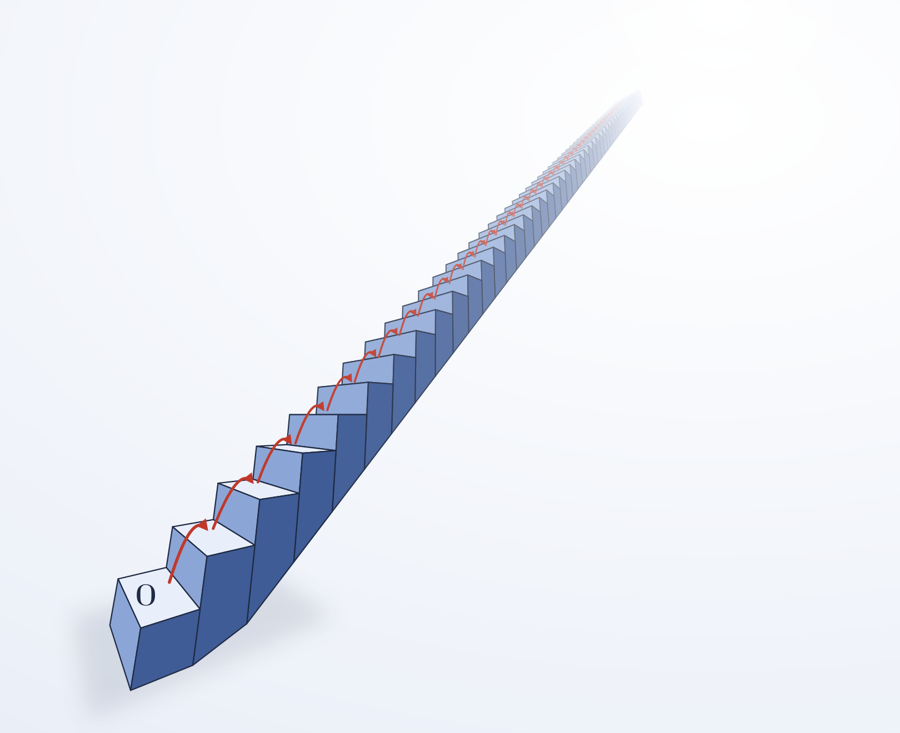

# 0. Index.

# 1. Introduction: Algebraic structure of natural numbers.

In this post we are going to present the *natural numbers*, usually denoted by $\mathbb{N}$. 

Essentially, **$\mathbb{N}$ abstracts the recursive iteration process**, $\mathbb{N}$ is the structure in which count makes sense. 

Dedekind and Peano isolates a minimal machinery; a starting point, and a unary operation (the successor) that never returns to the origin and never collides, plus an the induction principle which generates a *unique* structure identifiable with an *existing* model of this system.

Let's explain this two points a little further:

- First, the Peano axioms determines a unique structure despite isomorphism. 

    This is exceptional, algebraic axiomatics like vector spaces are deliberately non-categorics, in the sense that there are at least two structures identifiable as vector spaces which are not isomorph between them (think in $\mathbb{R}$ and $\mathbb{R}^2$).

    We say that **the axiomatic developed by Peano-Dedekind is categoric** because all the peano systems are indeed isomorphfic to each other. In some sense, the axiomatic system fix completly the structure and is what we call an **isomorphism class**.

     

- Second, an isomorphism class needs a canonical representant of this isomorphism. We can think in the model but we need to ensure that the model can be instantiated in some structure fitting the axiomatic system. This structure, the canonical representant of the natural numbers, are the Von Neumann's Ordinals.

     

The resulting structuralist reading is clear: $\mathbb{N}$ is an *isomorphism class*; $\omega$ (the von Neumann finite ordinals) is a canonical representant and *categoricity* ensures that the choice of the structure is irrelevant as long as it fits as a peano's system.

 

# 2. Peano's system.

## 2.1. Definition. Axioms and Example.

We define a Peano's system to be a triple $(N,0,S)$ with $N$ a non-empty set, $0 \in N$ and the sucessor function $S : N \to N$, satisfying the following axioms:

- $P1, \nexists n \in N : s(n) = 0$, or in simple terms $0$ isn't the sucessor of any other element.

- $P2, \forall m,n \in N : m \neq n \implies s(m) \neq s(n)$

- $P3$ **Induction Principle**:

    $$\forall A \subseteq N \quad \big[\big(0 \in A \wedge \forall n(n \in A \implies s(n) \in A) \big) \implies A = N\big]$$

     

So, the element $0$ is what we call *the starting point*, the sucessor function needs to be inyective in order to not "collide" (which is as much as to say that it do not goes back to any element) and we make the whole structure to satisfy the *Induction Principle* which asserts that $S$ does not left any element in $N$ by going on from sucessor to sucessor.

We can imagine it as a staircase with infinite steps. The ground step is our $0$ and the inmediate step above is the sucessor, then let's us think that if we get a bunch of steps $A$ such the ground step is in $A$ and $A$ contains the sucessor of any step in $A$, then $A$ is the whole staircase.

Essentially, a peano's system is a structrure that allows to go through all his elements in a consecutive way.

 

## 2.2. Peano's system as an isomorphism class. Pointed Unary Algebra and Morphisms.

We are going to give a brief commentary about how a Peano's system is understanded in moderns days in mathematics.

Any Peano's system is what we call *Pointed Unary Algebra*. Decodifying the name; is nothing but a single unary operation; $S : N \to N$, defined within a pointed set; $N$, meaning; a set with one distinct element among the rest; $0$.

The quid about it is that a pointed unary algebra is the complete abstraction of the free recursive iteration without collision, the bare-bones pattern of “starting somewhere and repeatedly pressing a step button”: a clock, a staircase, a sequence or even a turing machine are all the same type of structure from the Algebra point of view, this is what this is all about.

Observe that what we usually call 'sequence' $\mathbb{N} \to A$ is the proper operation of iteration. The universal property of $\mathbb{N}$ it is the statement “iterating $n$ times is well-defined”, without circularity.

 

In Algebra a morphism is an application between two algebraic structures preserving the operation defined on them. 

In this case, a morphism $m$ between two peano's system $(S,0,N),(S',0',N')$ preserves the starting point and the iteration process (this is that, the image of the $n$-step is the $n$-step of the image of the starting point) by definition:

$$\begin{cases} m(0) = 0' \\ m(S(\underbrace{\ldots}_nS(0))) = S'(\underbrace{\ldots}_nS'(m(0)))\end{cases}$$

Is easy to see that in this conditions $m$ is totally fixed. Between two peano's system a morphism transforms one to another indistinguibly, or, in other words, the unique valid type of morphism between peano's system is an isomorphism.

An isomorphism behaves as a mathematical identifier of algebraic structures. Meaning, Peano's system is always the same structure despite isomorphism. This is what lead us to say that Peano's system is an *isomorphism class*; a categoric axiomatic system that enterely describes the structure it defines.

 

# 3. Canonical representant: von Neumman Ordinals.