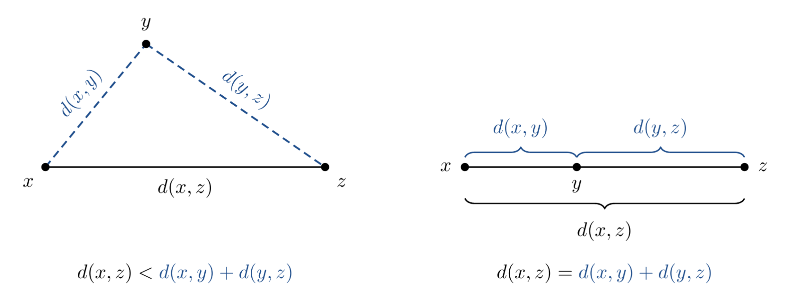
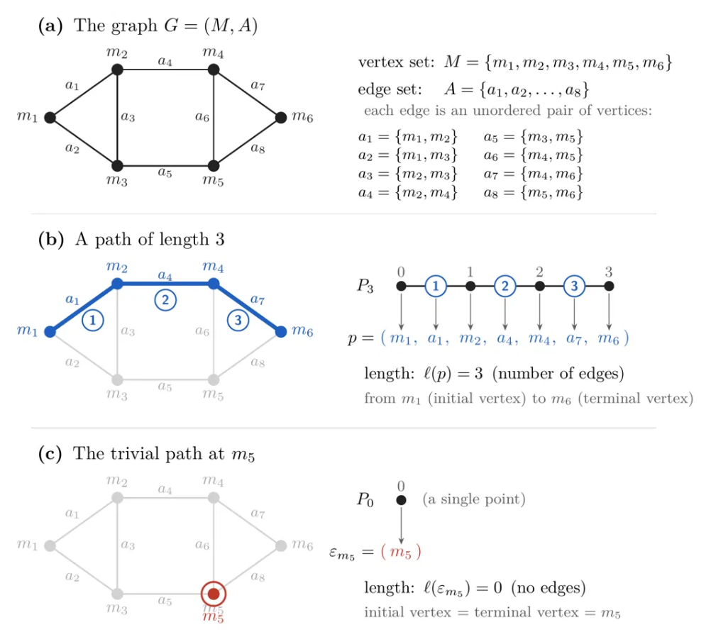

# 0. Index.

- 1. Introduction.
- 2. Metric Spaces. Distance.
- 3. Isometries. Isometric Spaces.
    - 3.1. Definition.
    - 3.2. Theorem 1.7. Composition and Inverse of isometries are isometries.

     

# 1. Introduction.

Geometry comes from greek. The term '-metry' refers to measure, because the origins of geometry takes place in how to measure land portions or river floods. In mathematics, the *metric space* is the structure which gives sense to the action to measure.

In mathematics, *measure* aqcuires a more generic form. To measure in mathematics is all about to abstract some property between two elements and translate it to real numbers satisfying some properties forgetting what is being measured and how is being measured.

 

# 2. Metric Spaces. Distance.

Let be $M \neq \varnothing$. Then, a function $\delta : M \times M \to \mathbb{R}$ is called *metric* or *distance function* on $M$ if the following conditions are satisfyied by any $x,y,z \in M$:

- **$(M1)$ Positive definiteness**. This is, is always positive for any pair of distinct elements and zero for the same element:

    $$[\delta(x,y) > 0 \iff x \neq y ] \wedge [\delta(x,x) = 0]$$

- **$(M2)$ Simmetric**. The property is intrinsic of the pair, indifferent to the way of measure:

    $$\delta(x,y) = \delta(y,x)$$

- **$(M3)$ Triangular Inequality**: This third axiom stablish how distances relate each others:
    
    $$\delta(x,y) \leq \delta(x,z) + \delta(z,y)$$

    Observe that, $M1$ stays that any distance between two distinct points is positive. $M3$ stays that, further more, the distance between two points is not only positive but equal or greater than the same measured distance passing through an intermediary. 

    In simple terms: taking a detour never shortens the way, it is formalizing the idea that the shortest distance between two points is the one involving only those two points, prescinding any other third party.

    

 

The pair $(M, \delta)$ satisying the conditions above is called *Metric Space*.

 

# 3. Isometries. Isometric Spaces.

## 3.1. Definition.

We are now going to present those biyective functions preserving distances. Meaning the images of this functions retains invariant the real number given by the metric in each space.

Let be $(M,\delta)$ and $(M',\delta')$ two metric spaces and $g: M \to M'$, then we say that $g$ preserves the distance if:

$$\delta'(g(x),g(y)) = \delta(x,y) \quad \forall x,y \in M$$

Then, $g$ is called *isometry* if preserves the distance function and if is biyective. 

Two spaces are called *isometric*, if at least one isometry can be considered between them. In this context, $(M,\delta)$ and $(M',\delta')$ are say to be isometric.

 

## 3.2. Theorem 1.7: Composition and Inverse of isometries are isometries. The group of isometries of a metric space.

We are now going to see that the composition and the inverse of isometries are isometries as well and we will leverage this result to present the group of the isometries of a metric space.

 

Let be $(M,\delta), (M',\delta'), (M'', \delta'')$ and $g \in M^{M'}, g' \in {M'}^{M''}$, then $ g' \circ g \in M^{M''}$ and $g^{-1} \in {M'}^M$ are isometries.

- First, take $x,y \in M$ and consider $g'\circ g(x), g' \circ g(y) \in M''$. Since $g,g'$ are isometries by premise, the $g' \circ g$ is biyective and preserve distance since:

    $$\delta''(g'\circ g(x), g' \circ g(y)) = \delta''(g'(g(x)), g'(g(y))) = \delta'(g(x),g(y)) = \delta(x,y)$$

    Since $x,y$ are arbitrary values, the step above are valid for any pair of values of $M$ and the composition is an isometry.

     

- Also, since $g$ is biyective we can consider the inverse $g^{-1}$ to be a function and biyective as well. Consider again $s,t \in M'$, then since $g$ is biyective there are $x,y \in M : g(x) = s, g(y) = t$ meaning that $g^{-1}(s) = x, g^{-1}(t) = y$. Hence, we can state that:

    $$\delta(x,y) = \delta'(g(x),g(y)) \iff \delta(g^{-1}(s),g^{-1}(t)) = \delta'(g(g^{-1}(s)),g(g^{-1}(y))) = \delta'(s,t)$$

    And since $s,t$ are arbitrary values, this argument is valid for any pair of elements in $M$.

     

Now, let's name as $Isom(M)$ to the set of all isometries $g \in M^M$. We have demonstrated that the inverse and composition of isometries are isometries, the function $id \in M^M$ is clearly an isometry and the composition of functions verifies asociativity, thus, in the end the structure $(Isom(M),\circ)$ is a group. This is, is a structure with an operation that behaves well enough to formulate basic equations. (Take care that is not a commutative group).

 

# 4. Example: Graphs.

## 4.1. Definition and basic notions.

Let's instante the concept defined above in an example. Let's consider the set $M$ to be a finite set whose elements we will call 'vertex'. Asociated with $M$ we can find the subset $A \subset M^2$ whose elements we will call 'edges'. The pair $G = (M,A)$ is called *graph*.

 

We say that a *path* is a finite ordered tuple of vertex $p=(m_1,m_2, \ldots, m_l) \in M^l$ such each vertex is tied to the contiguous vertex by an edge, meaning $(m_i,m_{i+1}) \in A \quad \forall i \in[l-1]$.

The number of edges in a path is called *length* of the path.

A graph such any pair of vertex exists a path involving them is called *connected graph*.

 

## 4.2. Distance of a connected graph. Connected graph as a metric space.

Let's consider $G = (M,A)$ a connected graph. 

Then we define the function $\delta_G M \times M \to \mathbb{R} \mid \delta_G(x,y) = \min\Set{l(p) \mid x,y \in p}$. In our image above, $\delta_G(m_1,m_6) = 3$. Is worth to note that in our definition of $\delta$ we are making an abuse of notation by stating $x,y \in p$ since $p$ is not an ordinary set, but here we would make an effort and assume that two vertex $x,y$ are "in" a path when both take place at some position of the ordered pair.

Observe that $\delta_G$ is a valid metric:

- $\delta_G(x,y) > 0 \quad \forall x,y \in M : x \neq y$. Note that all pair of distinct vertices are joined by some path (since $G$ is connected) and the path is not trivial (since the vertices are distinct) so it contains at least one edge and the number of edges is above $0$.
- $\delta_G(x,x) = 0$ And is well defined by the trivial path which contains $0$ edges. This with the point above make our distance to be Positive definiteness.

- $\delta_G(x,y) = \delta_G(y,x) \quad \forall x,y \in M$. If the vertices are the same then in both case is cero. If not, the shortest path between to vertex coincides with independence of the direction since this is not a DAG. So $\delta_G$ is Simmetric.

- Lastly, consider $x,y \in M$ and the path, $p_{xy} : \delta_G(x,y) = l(p_{xy})$. Then, for any other vertex $z$ in $M$, there are two posibilities, $z \in p$ or $z \notin p$.

    If $z \in p$, then $p = p_{xz} \cup p_{zy}$ (here is again an abuse of notation, since $p$ is not an ordinary set and is questionable to use set theory notions on it, but we will asume that a union of path is just the joint of the tail of the first with the head of the second). Then, $\delta_G(x,z) = l(p_{xz})$ and $\delta_G(z,y) = l(p_{zy})$, then we have $\delta_G(x,y) = \delta_G(x,z) + \delta_G(y,z)$, (observe that if not and, for example, there was $p'\_{xz}$ shortest than $p\_{xz}$ then $l(p\_{xz} \cup p\_{zy})< l(p'\_{xz} \cup p\_{zy})$ in contradiction with our premise).

    If $z \notin p$, then $l(p) < l(p\_{xz} \cup p\_{zy})$ by the same argumentation that before. So, in any case, we can state that:

    $$\delta_G(x,y) \leq \delta_G(x,z) + \delta_G(z,y) \quad \forall x,y,z \in M$$

    Which is the Triangular Inequality.