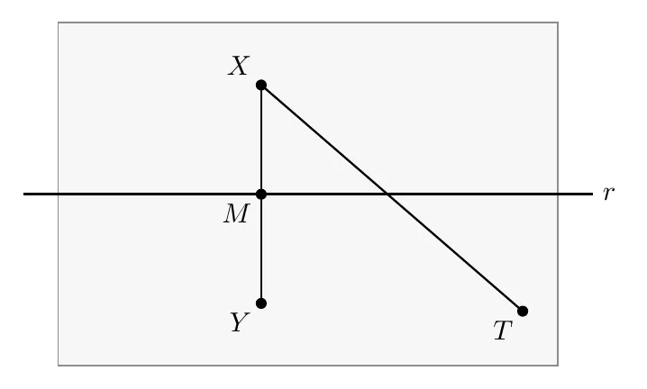
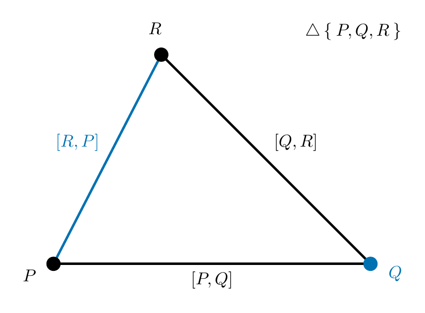
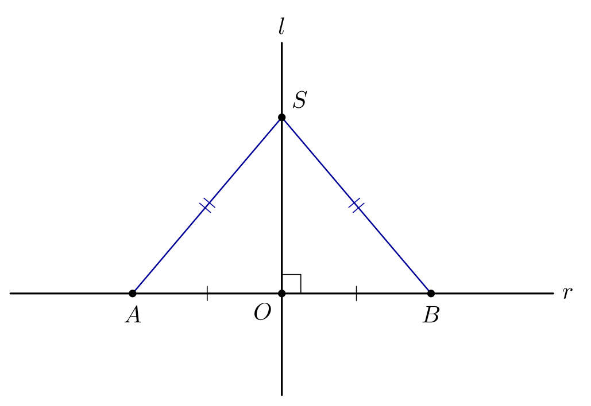
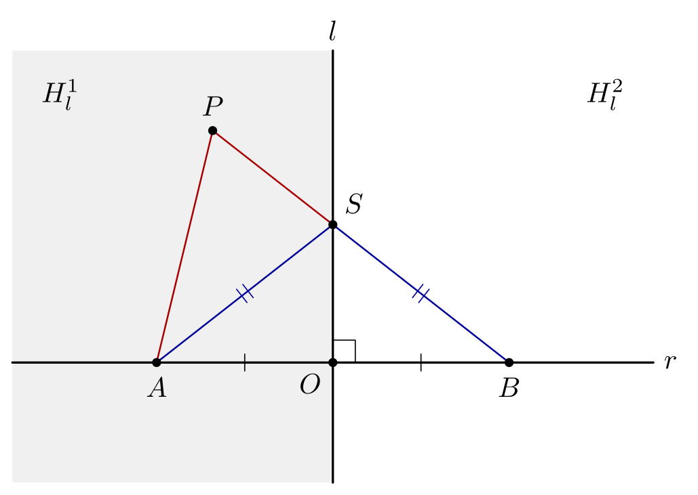

# 0. Index.

1. Introduction.
2. Axiom P1. The plane's metric space. Distance.
3. Lines.
- 3.1. Line: Definition.
- 3.2. Segments and Lines in the plane.
- 3.3. Axiom $P2$: More than one line in $\textbf{P}$. The line passing through two points.
- 3.4. Parallel and Secant lines.
- 3.5. Axiom $P3$: Ruler Postulate.
    - 3.5.1. Definition.
    - 3.5.2. Observation 2.8: Midpoint.

- 3.6. Exercise 1. Characterizating the isometries of $P3$.
- 3.7. Rays.
    - 3.7.1. Definition.
    - 3.7.2. Observation 2.10. Points in distinct side of a third point.

4. Axiom P4: Separation Axiom.
- 4.1. Definition.
- 4.2. Immediate consecuences.

5. Triangles.
- 5.1. Definition.
- 5.2. Theorem 2.16: Pasch Axiom.

6. Isometries.
- 6.1. Theorem 2.18. Structures preserved by isometries of the plane.
    - 6.1.1. Segments.
    - 6.1.2. Alignment.
    - 6.1.3. Lines.
    - 6.1.4. Half-planes and Rays.
- 6.2. Axioms about isometries of the plane.
    - 6.2.1. Axiom $P5$. Movility Axiom. Definition 2.19: Congruent Figures.

     

# 1. Introduction.

In this chapter we are going to develop the *Plane Euclidean Geometry* in an axiomatic way. This basically means we will start by announcing some properties assuming them as true or principles (axioms) from which we will develop other properties such theorems, lemma, proposition, etc.

This axioms will be stablished in set theory language, in this sense, we will say that the plane is a set of points, the figures on the plane such lines or triangles are subsets of the plane satisfying some conditions and distances, isometries and more are applications.

Is important to keep in mind that PEG emerges as an abstraction of what we can draw in a paper with a pencil. The objective of this course is to form the student to instantiate clear or strong intuitions into logically correct and syntactically well-constructed propositions.

 

# 2. Axiom P1. The plane's metric space. Distance.

Let's consider the following two objects:

- The non-empty set called *Plain*; $\textbf{P}$, whose elements are called *points*; $A,B,C \ldots$

- An application $d :  \textbf{P}^2 \to \mathbb{R}$, called *distance*.

The axioms $P1 -P7$ for the PEG will characterize or shape $(\textbf{P},d)$, starting from the first one:

$$\boxed{\text{ Axiom P1: } (\textbf{P},d) \text{ is a metric space}}$$

 

# 3. Lines.

In [metric space's](https://gsanmi1.github.io/posts/2026/11/09/MetricSpaces/) post we discuss the concepts of segments and alignment. We will know extrapolate them in $\textbf{P}$ defining the *line* object.

 

## 3.1. Line: Definition.

A subset $r \subset \textbf{P}$ is called a *line* if the following conditions are meet:

1. $\exists A,B \in r : A \neq B$. 

2. $\forall A,B,C \ [A,B,C \in r \implies Al(A,B,C)] $.

3. $\forall A,B \in r : A \neq B, \forall X \ [Al(A,B,X) \implies X \in r]$.

This means that lines are non-empty, non-singleton $(1.)$, aligned $(2.)$ subsets that owns any point of the plane aligned with his own points $(3.)$.

 

## 3.2. Segments and Lines in the plane.

We are going to see that any segment of endpoints included in a line is a subset of the own line. This is a very intuitive result keeping in mind the definition given above. We recall that segments are those points which do not increment the distance between the endpoints when this is measured passing through them, and alignment between three points literally means for one point to be included in the segment of the other two.

Having said that, let be $r \subset \textbf{P}$ a line and $A,B \in r : A \neq B$ which exists by $(1.)$ and consider $[A,B]$. By definition of the segment:

$$[\forall X \in [A,B] \ (Al(A,B,X) \underbrace{\implies}_{(3.)} X \in r)] \implies  [A,B] \subset r$$

Observe that $A = B \implies [A,B] = \Set{A} \subset r$ since $A \in r$ by premise.

Hence, ultimately, we can state: $[A,B] \subset r \quad \forall A,B \in r$.

 

## 3.3. Axiom $P2$: More than one line in $\textbf{P}$. The line passing through two points.

The following axiom, $P2$ allows to difference $(\textbf{P},d)$ as a metric space from a single line, this is; from linear metric space. Basically, it states that in $\textbf{P}$ we can consider several different lines:

$$\boxed{ \begin{aligned}\text{ Axiom P2:}&  \\  (i) \quad & \exists A,B,C : \neg [Al(A,B,C)] \\  (ii) \quad & \forall A,B(A \neq B \implies \exists !r : A,B \in r)\end{aligned}}$$

Observe directly that:

- $(i)$ of $P2$ let us to consider at least one point not aligned with other two in $\textbf{P}$, meaning that the three are not in the same line.

- $(ii)$ of $P2$ let us to consider a line whenever we identify two distinct points of the plane and this line is unique. Note that the uniqness of the line is not necesary, is forced by the alignement logic of the structure (the points of two lines passing through two distinct points are enterely aligned with those two points, hence, each point is in his own line and in the other, thus perph lines are in fact the same line).

     

Then, using $P2's (i)$ we can consider three non-aligned points $A,B,C$, (observe that this means they are three distinct points, since one point and two points in the plane are always aligned points). Then, by $P2's(ii)$, we can consider $r$, unique, passing through $A,B$; $g$, unique, passing through $B,C$ and $h$, unique, passing through $A,C$. This three lines are distinct subsets of $\textbf{P}$.

$P2's(i)$ let's to consider it and $P2's (ii)$ let us to build it.

 

For now on, we will design the unique line passing through $A,B \in \textbf{P}$ as $r_{AB}$.

 

## 3.4. Parallel and Secant lines.

### 3.4.1. Parallel and Intersection: Definition.

Let be $r,t \subset \textbf{P}$ two lines, then we say that:

- Both lines are *secant* (or just, perph intersect) $\not{\|\|}$ when share a unique point:

    $$r \not{||} \ \ t \iff \exists A \in \textbf{P} : r \cap t = \Set{A}$$

     

- We say perph are *parallel* lines $\|\|$ when do not share any points:

    $$r \ \| \ t \iff r \cap t = \varnothing$$

     

### 3.4.2. Theorem 2.7: Characterization of the pairs of lines in $\textbf{P}$.

**Is clear that, given two lines $r,t \subset \textbf{P}$, then, there are three posibilities; perph are parallel lines, secant lines, or the same line.** 

As subsets of $\textbf{P}$ if perph doesn't share points $r \cap t = \varnothing$, then are parallel, if perph share exactly one point $r \cap t = \Set{A}$, then are secant lines.

If perph share more than one point, then, let be $A,B \in r \cap t : A \neq B$ and consider $r_{AB}$. The same reasoning is valid for $r$, take some point $X \in t$, then we have by $(2.)$ of lines's definition: $A,B,X \in t \implies Al(A,B,X)$, then also by $(3.)$ $X \in r_{AB}$ and since $X$ is an arbitrary point of $t$, then $t \subseteq r_{AB}$. The same reasoning demonstrates that $r_{AB} \subseteq t$, hence $t = r_{AB} = r$.

 

(Observe that we demonstrate this result by forgetting the uniquity statement of $P2$, then the demonstration would be much sorter. But is worth to demonstrated this way in order to remember that uniquity is not necesary).

 

## 3.5. Axiom $P3$: Ruler Postulate.

### 3.5.1. Definition.

We are already familiar with this result, which basically recovers the analysis's fact about real numbers as positions in a line (Dedekind's cut) and transfer it too the line's subsets of $\textbf{P}$.

Remember that $(\textbf{P},d)$ is a metric space and since any line is a subset of the plane; $r \subset \textbf{P}$, then the set $(r,d\|_{r \times r})$ inheritates the metric space structure from the first one. Having this said, then:

 

$$\boxed{ \text{ Axiom } \text{P3 (Ruler Postulate)}:  \\  Isom((r,d|_{r \times r}),(\mathbb{R},\delta_\mathbb{R})) \neq \varnothing \quad \forall \text{ line } r }$$

 

Observe that we are saying that we can measure the distance between two points in any line as we would measure it in $\mathbb{R}$, this is a very powerful statement since this allow us to translate some mathematical properties of the field $(\mathbb{R},+, \cdot)$ to any line.

Observe that $P3$ let us to consider, for any line $r$, some biyection $\gamma \in \mathbb{R}^r$ that preserves the distance between the points of $r$ and the real numbers (measured the last ones with the absoulte value metric we see in Chapter 1):

$$\delta_\mathbb{R}(\gamma(X),\gamma(Y)) = | \gamma(X) - \gamma(Y) | =  d(X,Y) \quad \forall X,Y \in r$$

Then, we are inyecting the real distance to any generic line in the plane.

 

### 3.5.2. Observation 2.8: Midpoint.

Let's define a useful object in the following sections that also serve us as a good application example of the axiom $P3$. Let $r \subset \textbf{P}$ be a line and $A,B \in r : A \neq B$, then:

- $\exists! M \in r : d(A,M) = d(M,B)$ and we call it *midpoint*.

    By $P3$, we know that we can measure $r's$ as if they were real elements, importing an isommetry from $Isom((r,d\|_{r \times r}),(\mathbb{R},\delta\_\mathbb{R}))$ which is not empty (by $P3$). So, let be $\gamma \in Isom((r,d\|\_{r \times r}),(\mathbb{R},\delta\_\mathbb{R}))$, then, let's call $X$ to be the real unknown satisfying:
    
    $$|\gamma(A) - X| = |\gamma(B) - X|$$

    Squaring perph parts, dusing the ifference of square's identity and cleaning $X$ (keeping in mind that $A \neq B$ and $\gamma$ is a biyection) we have that this real number is determinated by the expression:

    $$X = \frac{\gamma(A) + \gamma(B)}{2}$$

    Then, since $X$ do exists as a real number, there must exists some unique $M \in r : M = \gamma^{-1}(X) = \gamma^{-1}(\frac{\gamma(A) + \gamma(B)}{2})$.

     

- Observe quicly the result above forces $M \in [A,B]$, if not, $A,B,M \in r \implies Al(A,B,M)$, (by $(2.)$ of the line's properties), and by the alignment definition in a metric space (which state that three alignment elements means for one of them to be in the segment formed by the other two):

    $$M \notin [A,B] \iff (A \in [M,B] \oplus B \in [M,A])$$

    But:

    $$ \begin{aligned} A \in [X,B] \iff d(M,B) = d(M,A) + d(A,B) \underbrace{>}_{A \neq B} d(M,A)\\ \\  B \in [M,A] \iff d(M,A) = d(M,B) + d(A,B) \underbrace{>}_{A \neq B} d(X,B) \end{aligned}$$

    Hence, by the trycotomy property of the real numbers, the only compatible position for $M$ is to be in the segment of endpoints $A,B$.
    
     

Hence, as a summary, $\forall A,B \in \textbf{P} \ \exists! M \in [A,B] : d(A,M) = d(M,B)$, and we call $M$ to be the midpoint between $A, B \in \textbf{P}$; $M = mid[A,B]$. (Note that trivially $A=B \implies mid[A,B] = A = B$).

 

## 3.6. Exercise 1. Characterizating the isometries of $P3$.

**Let be $r \subset \textbf{P}$ and $\gamma, \gamma' \in Isom((r,d\|\_{r \times r}),(\mathbb{R},\delta\_\mathbb{R}))$, then** 

$$\exists a \in \mathbb{R} : [(\gamma' \circ \gamma^{-1} (x) = a + x \quad \forall x \in \mathbb{R}) \oplus (\gamma' \circ \gamma^{-1} (x) = a - x \quad \forall x \in \mathbb{R})]$$

Observe that this result is immediate from the fourth section of the exercise 2 of the post of MetricSpaces.

Since:

$$\delta_\mathbb{R}(x,y) = d(\gamma^{-1}(x), \gamma^{-1}(y)) = \delta_\mathbb{R}(\gamma' \circ \gamma^{-1}(x),\gamma' \circ \gamma^{-1}(y))$$

Then, $\gamma' \circ \gamma^{-1} \in Isom((\mathbb{R},\delta_\mathbb{R}))$ and there exists $\tau \in \mathbb{R}$, $\sigma \in \Set{-1,1}$ such:

$$\gamma' \circ \gamma^{-1}(x) = \sigma x + \tau \quad \forall x \in \mathbb{R}$$

Call $\tau = a$ and conmutate the expression, getting:

$$\gamma' \circ \gamma^{-1}(x) =a + \sigma x  \quad \forall x \in \mathbb{R}$$

Note that one of the conclusions we can get from this exercises is that the difference between two isometries $\gamma, \gamma' \in \mathbb{R}^r$ as $P3$ requires is as much: $\gamma' = \sigma \gamma + \tau : \sigma \in \Set{-1,1} \wedge \tau \in \mathbb{R}$, again, a uniform slidging, with orientation and wide.

 

## 3.7. Rays.

### 3.7.1. Definition.

Let be $r \subset \textbf{P}$, $P \in r, \gamma \in Isom((r,d\|\_{r \times r}),(\mathbb{R},\delta\_\mathbb{R}))$, then we define as *ray with vertex $P$* to the sets:

$$\Set{Q \in r \mid \gamma(Q) > \gamma(P)}, \quad \Set{Q \in r \mid \gamma(Q) < \gamma(P)}$$

We often can refer to any of perph sets as $\overline{r}$. Observe that perph rays doesn't joint in to $r$:

$$\Set{Q \in r \mid \gamma(Q) > \gamma(P)} \cup \Set{Q \in r \mid \gamma(Q) < \gamma(P)} = r \setminus \Set{P}$$

We say two points $S,T$ are on the same side of $P$ when perph are in the same ray with vertex $P$.

 

Let's do a minor observation to discuss why we the ray do not depedend on the select $\gamma$. Intuitively, we did see in exercise $6.1$ that any $h \in (\mathbb{R},\delta_\mathbb{R})$ is essentially a uniform oriented sliding (what later we'll call a translation plus a rotation over a line) over $\mathbb{R}$, since this the only way to preserve distances in a line.

Formally, if $a,b,c \in \mathbb{R}$ distinct, the trycotomy and transitivity properties of the total order in $\mathbb{R}$ stablish that, for example and without loose generality: $a < b < c$. If we choose an isommetry $h$, there exists $\sigma \in \Set{-1,1} \wedge \tau \in \mathbb{R} : h(x) = \sigma x + \tau$. Then, the images of $a,b,c$ by $h$ satisfies: 

$$\begin{cases}h(c) - h(b) = \sigma (c-b) > 0 \\ h(b) - h(a) = \sigma (b-a) > 0\end{cases}$$

Then, we have two posibilities depending on the value of $\sigma$:

$$\begin{cases} h(a) < h(b) < h(c) \quad \sigma = 1 \\ h(c) < h(b) < h(a) \quad \sigma = -1\end{cases}$$

Geometrically we would say that $h$ "preserve" the segment (remember that in any metric space is $[x,y] = [y,x]$). 

Observe nevertheless that an isommetry could invert the orientation, this is important in $\mathbb{R}$ because any point is identified by a number which is distinguishable from any other through a total order, we will see that $r$, despite be isommetric, is not a full copy of $\mathbb{R}$ in $\textbf{P}$ (is just a metric copy) and one of the differences is precisely this one, so orientation in the lines of the plane doesn't matters at all.

Axiom $P3$ tell us that any line $r$ in the plane is an isommetric structure to $\mathbb{R}$, hence, any traduction of the line to $\mathbb{R}$ done by some isommetry $\gamma \in \mathbb{R}^r$ as $P3$ requires is in summary a replication of the slidging shown above. Meaning that, take $r \subset \textbf{P}$ and $X,Y,Z \in r$, distinct, such $Z \in [X,Y]$. Then, in terms of $\gamma$ is $\gamma(Z) \in [\gamma(X), \gamma(Y)]$, let's suppose $\gamma(X) < \gamma(Z) < \gamma(Y)$, now, let be $\gamma ' \in \mathbb{R}^r$ another isommetry as $P3$ requires, then $\gamma' \circ \gamma^{-1} \in Isom(\mathbb{R},\delta_\mathbb{R})$ and just as we see above there are two posibilities:

$$\gamma(X) < \gamma(Z) < \gamma(Y) \implies \begin{cases}\gamma' \circ \gamma^{-1}(\gamma(X)) < \gamma' \circ \gamma^{-1}(\gamma(Z)) < \gamma' \circ \gamma^{-1}(\gamma(Y)) \\ \gamma' \circ \gamma^{-1}(\gamma(X)) > \gamma' \circ \gamma^{-1}(\gamma(Z)) > \gamma' \circ \gamma^{-1}(\gamma(Y))\end{cases}$$

But $\gamma'\circ \gamma^{-1}(\gamma(X)) = \gamma'(X) \quad \forall X \in r$, then:

$$\gamma(X) < \gamma(Z) < \gamma(Y) \implies \begin{cases}\gamma'(X) < \gamma' (Z) < \gamma' (Y) \\ \gamma'(X) > \gamma' (Z) > \gamma'(Y)\end{cases}$$

Which means that essentially the election of $\gamma$ doesnt matter in the ray definition because it preserves the segments and only invert the line as much, but, since the points in a line are indistinguisable among them (despite the distance's identification) this is not much of a problem.

In other words, the election of $\gamma$ could interchange perph rays relative to a vertex of a line as much, but as a matter of a fact, we dont care because this change isn't metrically appretiable.

 

### 3.7.2. Observation 2.10. Points in distinct side of a third point.

Two points $X,Y \in r$ are in different sides of $P \in r$ only iff $P \in [X,Y]$. Let be some $\gamma \in \mathbb{R}^r$ as $P3$ requires, then, if $X$ and $Y$ are in different sides of $P$ in $r$ it could satisfy, without loose generality: 

$$\gamma(X) < \gamma(P) < \gamma(Y) \iff \gamma(P) \in [\gamma(X), \gamma(Y)] \iff P \in [X,Y]$$

Note that since $[X,Y] = [Y,X]$, the case $\gamma(X) > \gamma(P) > \gamma(Y)$ is exactly the same, the equivalence presentation closes the demonstration.

 

# 4. Axiom P4: Separation Axiom.

## 4.1. Definition.

Above we did split a line in a point and identified two sides relative to the vertex. We are now going to present the separation axiom, $P4$, which extends this splitness to the whole plane $\textbf{P}$.

 

$$\boxed{ \begin{aligned}\text{ Axiom P4:} &  \quad  \forall \text{ line } r \ \exists H^1, H^2 \subset \textbf{P} :   \\  (i) \quad & H^1 \cup H^2 = \textbf{P} - r \\  (ii) \quad & \forall X,Y( X,Y \in H^i \implies  [X,Y] \subset H^i) \quad i = 1,2 \quad \\ (iii) \quad & \forall X,Y( (X \in H^i \wedge Y \in H^j) \implies  [X,Y] \cap r \neq \varnothing) \quad i,j = 1,2; \quad j \neq i \quad \end{aligned}}$$

 

Let's observe something interesting, let's take two distinct points $M, M' \in \textbf{P}$ and consider the line $r_{M,M'}$. Then, by axiom $P2$, consider a third point $X \in \textbf{P} : \neg Al(X,M,M') \iff X \notin r_{M,M'}$, and consider $Y \in \textbf{P} : M = mid[X,Y]$, then we call:

$$H^1 = \Set{T \mid [T,X] \cap r_{MM'} = \varnothing }$$

$$H^2 = \Set{T \mid [T,Y] \cap r_{MM'} = \varnothing }$$

Is easy to see that $(i)$ and $(ii)$ applies for our construction, how ever, how can we garantee $(iii)$? $(iii)$ is basically the statement that asserts that is impossible to go from one set to the other without cross $r_{MM'}$, but this is not true in three dimensions geometry for example:

$P4$ commit us to believe that $\textbf{P}$ is a metric structure for which the line is enough and necesary to split it in half and, as a consecuence, is a garantee that the cost of go through a line is to cut it.

In summary, $P4$ is what converts $\textbf{P}$ into a plane metric space:

 

We call $H^i, \ i=1,2$ half-plane of edge $r$. We say two points of $\textbf{P}$ are in the same side of $r$ if perph are in the same half-plane.

 

## 4.2. Immediate consecuences.

Observe that, as a consecuences of the postulates of $P4$:

1. $H^i \neq \varnothing \quad i = 1,2$

    We demonstrated this before, is garanteed by $P2$. In $\textbf{P}$ there are at least three points not aligned so at least one of the subsets $H^i$ is not empty. Then considering the line passing through the not aligned point and other point of the other line, we can infere that the opposite set is also not empty.

     

2. $H^1 \cap H^2 = \varnothing$

    This is precisely what follows from $(iii)$. Reasonning to the absurd, suppose: $H^1 \cap H^2 \neq \varnothing$, then:

    $$X \in H^1 \cap H^2 \underbrace{\implies}_{(iii)} ([X,X] \cap r \neq \varnothing \iff X \in r) \implies H^1 \cup H^2 \neq \textbf{P} - r$$

    Entering in contradiction with $(i)$.

     

3. $P^i \in H^i \implies H^i=\Set{T \mid [T, P^i] \cap r = \varnothing} \quad i = 1,2$

    Observe that:
    
    $$X \in H^i \iff [X,P^i] \subset H^i \iff [X,P^i] \cap r = \varnothing$$
    
    We also see that $(i)$ and $(ii)$ emerges naturally, hence, the $Axiom P4$ core is in fact the third condition; $(iii)$.

     

4. Observe that, given two lines $r,s : r \not{\mid \mid} \ s$. Then, observe that ${H^i}\_r \cap s : i = 1,2$ are precisely the rays of $s$ relative to $r \cap s  \in \text{P}$.

     

# 5. Triangles.

The triangles are the basic figures of the plane geometry.

 

## 5.1. Definition.

Let $P,Q,R \in \textbf{P} : \neg Al(P,Q,R)$. Then we call as *triangule of vertex $P,Q,R$* to:

$$\triangle\Set{P,Q,R} := \Set{P,Q,R,[P,Q],[Q,R],[R,P]}$$

This singular structure makes his elements to have specific name:

- The points $P,Q,R$ are called *vertex* of the triangle.
- The segments of the vertex of the triangle are called *sides* of the triangle.

We say a vertex and a side to be *opposite* if the vertex does not belongs to the side as a point, for example $Q \notin [R,P]$:

 

## 5.2. Theorem 2.16: Pasch Axiom.

We are now, making use of $P4$, proove an important result of triangles. The purpouse is to highlight the importance of $P4$ axiom using triangles prooving a result that at first looks trivial.

 

Given some triangle $\triangle\Set{P,Q,R}$, then if some line $r$ cross $[P,Q]$, then is forced to cross either $[R,P]$ or $[R,Q]$. Formally:

$$\forall \text{ line } r \forall \triangle \Set{P,Q,R}(r \cap [P,Q] \neq \varnothing \implies r\cap ([R,Q] \cup [P,R]) \neq \varnothing)$$

Note that, if we consider ${H^i}_r : i =1,2$ as the axiom $P4$, then $P \in {H^i}_r \wedge Q \in {H^j}_r$. So, by $P4, (iii)$ we have the following posibilities for $R$:

$$\begin{cases} R \in {H^i}_r \implies r \cap [R,Q] \neq \varnothing \\ R \in {H^j}_r \implies r \cap [R,P] \neq \varnothing \\ R \in r \implies r \cap ([R,Q] \cap [R,P]) \neq \varnothing\end{cases}$$

The key is to understand that, whenever you catch in a segment (and by extension, in a line) two points on distinct half-planes, then $A4, (iii)$ garantee the cut with the edge of the halp-planes.

 

# 6. Isometries.

Let's start saying, in vague terms, a structure is a set with some properties described as  relations between the elements of the set. For example in $(\textbf{P},d)$, to be a line $r$ is a particular behaviour of some elements of $\textbf{P}$ with $d$ described in three statements. 

Then, to say that "some application preserve the structure" means basically that the transformation do not alter the properties a set satisfy when it get transformed. In an intuitive sense, we would say that a structure is a set along with a defined behaviour between his elements and the preservation of the structure means to preserve the elements (existance) and the behaviour between them.

The Klein's Erlangen program stablish that the geometric properties of $\textbf{P}$ are precisely those such doesn't change by $Isom(\textbf{P})$. This means that, understand what structures are preserved by $Isom(\textbf{P})$'s group is essentially the study-object of plane euclidean geometry. 

 

## 6.1. Theorem 2.18. Structures preserved by isometries of the plane.

Let be $g \in Isom(\textbf{P})$, then we recall that $g$ take the distant as an invariant, meaning that $g$ do not alter the way in which the elements of $\textbf{P}$ interact between them through $d$:

$$d(g(X),g(Y)) = d(X,Y)$$

We are about to see that, departing from this point and keeping in mind that in $\textbf{P}$ the main structures we present before (half-plane, lines, segments and alignment) are defined in terms of the relation of the points of $\textbf{P}$ through $d$, then, any $g \in Isom(\textbf{P})$ preserves this same structures, in the sense that the properties caracterizing any of this structures holds in the image of the structure through $g$.

 

### 6.1.1. Segments and Isometries.

Recall that: $[A,B] = \Set{X \mid d(A,X) + d(X,B) = d(A,B)}$, so since is:

$$d(A,X) + d(X,B) = d(A,YB) \iff d(g(A),g(X)) + d(g(X),g(B)) = d(g(A),g(B))$$

The fact that $g$ is a biyection allow us to state that:

$$\forall X \forall g \in Isom(\textbf{P})(X \in [g(A),g(B)] \iff g^{-1}(X) \in [A,B])$$

Then: $g([A,B]) = [g(A), g(B)] \quad \forall g \in Isom(\textbf{P})$.

 

### 6.1.2. Alignment.

Since segments are preserved, then alignment is also preserved. 

Remember that three points of a metric space are said to be aligned if they coexists in the same segment. Hence, since segments are preserved we have:

$$\forall A,B,C \forall g \in Isom(\textbf{P})(Al(A,B,C) \iff Al(g(A), g(B), g(C)))$$

 

### 6.1.3. Lines.

Now, take a line $r \subset \textbf{P}$ and two distintct points $A,B \in r$ then, the third point in line's definition allow us to say wheter a point belong or do not belong to a line:

$$X \in r_{g(A)g(B)} \underbrace{\iff}_{(l, 2.) \Rightarrow, (l, 3.) \Leftarrow} Al(X,g(A),g(B)) \iff Al(g^{-1}(X),A,B) \underbrace{\iff}_{(l, 3.) \Rightarrow, (l, 2.) \Leftarrow} g^{-1}(X) \in r_{AB}$$

Note that $A \neq B \iff g(A) \neq g(B)$ since $g$ is biyective, so $r_{g(A),g(B)}$ is unique. 

The equivalences and $g$'s biyectivity allow us to say that  $g(r_{AB}) = r_{g(A)g(B)} \quad \forall \text{ line } r, \forall g \in Isom(\textbf{P})$.

 

### 6.1.4. Half-planes and rays.

Ultimately, suppose $r \subset \textbf{P}$ as before and ${H_r}^i : i=1,2$. Then, consider $g(H_r^i) : i = 1,2$. Then, take $P_i \in H^i_{r} : i = 1,2$ then we recall that: $H^i_r = \Set{X \mid [X,P^i] \cap r = \varnothing} : i=1,2$. Thus, take $X_i \in H_r^i : i =1,2$ and observe that necesarily: 

$$[X_i,P^i] \cap r = \varnothing \iff g([X_i,P^i]) \cap g(r) = \varnothing : i=1,2$$

First, from the statments above, we do know about segments and lines preservations which means that the second part of the equivalence means exactly what appears to mean; the image through $g$ of a segment and a line are segment and line aswell and this same premise let us to go back to the first equivalence through the inverse of $g^{-1}$ which is an isometry also. 

Note ultimately that the alignment preservation do the rest; if was $g([X_i,P^i]) \cap g(r) \neq \varnothing$, then alignment wouldn't preserve.

Then, the equivalences allow us to say that: $g(H_r) = H_{g(r)}$, this is; the image of a half-plane of edge $r$ is a half-plane of edge $g(r)$, but observe that in which side the halfplane lies depends on the image of $P^i : i =1,2$ which can change of half-plane, hence:

$$\forall \text{ line } r \forall g \in Isom(\textbf{P})(g(H_r^i) = H_{g(r)}^j \quad i,j = 1,2)$$

Note that we not force $i \neq j$, meaning that the images could invert and so can the rays of any line cutting $r$.

 

## 6.2. Axioms about isometries of the plane.

In $\textbf{P}$, the structures defined through the distance notion are used to create figures. The most direct and basic example about a figure in $\textbf{P}$ are the triangles, presented in the section $5$ of this same post. Then, the isometries of $\textbf{P}$, which we already know that preserve this structures, can also preserve (depends on what type of isometry is being used) the figures created with this structures of the plane.

The fundamental use of the elements of $Isom(\textbf{P})$ lies in the capability of manipulate, in a calculated manner, figures in the plane. With this purpouse we introduce the following axioms involving whether can we invoke an isometry of the plane with some concrete behaviour over the points of $\textbf{P}$.

 

Until now, we've discuss how the points behaves under the transformation of some $g \in Isom(\textbf{P})$. Now, we are going to see whether can we ensure the existance of an isometry of the plane sending those points between them, under what conditions in $\textbf{P}$ is justified to invoke a concrete isometry of the plane.

 

Is usefull to keep in mind that isometries in the plane are just forms of move things in the plane in a way the distances holds.

 

### 6.2.1. Axiom $P5$. Movility Axiom. Definition 2.19: Congruent Figures.

The following axiom let us believe that any where two pair of points sharing distance exists, there is an isometry sending one pair over the other:

$$\boxed{ \begin{aligned}\text{ Axiom } & P5:   \quad \forall  A_1,A_2,B_1,B_2  \\ & d(A_1,A_2) = d(B_1,B_2) \iff \exists g \in Isom(\textbf{P}) : g(A_i) = B_i \quad i=1,2 \quad \end{aligned}}$$

In this context, we say $g$ moves the pair $A_1,A_2$ over $B_1,B_2$.

 

Two figures in the plane $\mathcal{F_1}, \mathcal{F_2}$ are said to be *congruent* if there is an isometry moving one over the other:

$$\mathcal{F}_1 \simeq_d \mathcal{F_2} \iff \exists g \in Isom(\textbf{P}) : g(\mathcal{F}_1) = \mathcal{F}_2 $$

As an example, $P5$ ensures two segments are congruent when the distances between the endpoints coincides:

$$[X,Y] \simeq_d [X',Y'] \iff d(X,Y) = d(X',Y')$$

 

### 6.2.2. Axiom $P6$: Reflexion axiom. Definition and properties.

The following axiom is the formalization of what happens when we place a sheet of paper on the edge of a mirror and observe the reflexion.

$$\boxed{ \begin{aligned}\text{ Axiom } &  P6: \  \forall  \text{ line } r \ \exists \sigma \in Isom(\textbf{P}) : \\ & (i) \quad \sigma(X) = X \iff X \in r \quad \forall X \in \textbf{P}  \quad  \\ & (ii) \quad \sigma \circ \sigma = id_\textbf{P} \quad \end{aligned}}$$

We perpher to difference the isometry from the usual notation $g$ because it has its own name. An isometry as $P6$ is called *reflexion of axis* $r$ or simply *axial reflexion*.

 

Let's demonstrate some properties of the axial reflexion isometry. Let be $\sigma$ the axial reflexion of axis $r$, then:

1. $mid[X,\sigma(X)] \in r \quad \forall X \in \textbf{P}$.

    We already know that isometries preserves segments, specifically: $\sigma [X, \sigma(X)] = [\sigma(X), \sigma(\sigma(X))]$. In virtue of $P6, \ (ii)$, is $\sigma(\sigma(X)) = X$, so $\sigma([X,\sigma(X)]) =[X,\sigma(X)]$, hence $\sigma(mid[X,\sigma(X)]) = mid[X,\sigma(X)] \in r$ by $P6, \ (i)$. (Note that, we haven't said it before, but the mid point is the only equidistant point to the endpoints so, of course, is preserved by any isometry relative to the image of the segment).

     

2. Let be $H^i_r : i = 1,2$, then $\sigma(H^i_r) = H^j_r : i,j = 1,2 \wedge i \neq j$.

    Naturally, let be $X \in H^i_r$, then, by the statement above and $P4, \ (iii)$:
    
    $$mid[X, \sigma(X)] \in r \implies [X, \sigma(X)] \cap r \neq \varnothing \implies \sigma(X) \in H^j_r$$

    So $\sigma(H^i) \subseteq H^j$, but, since we know that the image of a half-plane by an isometry is a half-planes, and there is only two half-plane, then it must be $\sigma(H^i) =H^j : i,j = 1,2 \wedge i \neq j$.

     

# 7. Orthogonality.

## 7.1. Definition.

Let be $r,l \subset \textbf{P}$ two secant lines. 

Then, we say that $l$ is *orthogonal* to $r$ if any point of $l$ is equidistant to any pair of points of $r$ equidistants as well to the intersection point of perph lines:

$$l \perp r \iff d(S,A) = d(S,B) \quad \forall S \in l \forall A,B \in r : (A \neq B \wedge mid[A,B] = r \cap l)$$

 

## 7.2. Properties of orthogonal lines.

### 7.2.1. Isometries preserve orthogonality.

Note that, let be $l\perp r$ and $g \in Isom(\textbf{P})$.

We do know that $g$ preserves distances so, at first, $g(r), g(l)$ are two lines. 

Then, consider some $T \in g(l)$ and take $P,Q \in g(r) : P \neq Q, mid[P,Q] = g(r) \cap g(l)$. Observe that, since $g$ is biyective, we can consider $g^{-1} \in Isom(\textbf{P})$, then: 

$$\begin{cases} g^{-1}(P),g^{-1}(Q) \in r, \quad g^{-1}(T) \in l \\ P \neq Q \iff g^{-1}(P) \neq g^{-1}(Q) \\ mid[P,Q] \in g(r) \cap g(l) \iff g^{-1}(mid[P,Q]) \in r \cap l \\ \end{cases}$$

In this context, since $l \perp r$, then:

$$d(g^{-1}(T),g^{-1}(P)) = d(g^{-1}(T),g^{-1}(Q))$$

And since $g^{-1}$ is an isometry:

$$d(g^{-1}(T),g^{-1}(P)) = d(g^{-1}(T),g^{-1}(Q))\iff d(T,P) = d(T,Q)$$

Hence, since $T,P,Q$ were arbitrary points: $l\perp r \implies g(l) \perp g(r)$ and we can apply $g^{-1}$ obtaining $g(l) \perp g(r) \implies l \perp r$, ultimately $l \perp r \iff g(l) \perp g(r) \quad \forall g \in Isom\textbf{P}$. 

 

### 7.2.2. Theorem 2.25. Characterization of the line orthogonal to other one.

We are now considering two orthogonal lines $l \perp r$, then we are going to describe the points of $l$ in terms of two points of $r$.

$$l =\Set{ X \in \textbf{P} \mid d(X,A) = d(X,B) : A,B \in r \wedge A \neq B \wedge mid[A,B] = r\cap l}$$

By the definition of orthogonality, is easy to see that any point of $l$ satisfies the condition. The proof goes about to demonstrate that $l$'s points are the only points in the plane satisfying this coinditions.

 

Take some point $P \in \textbf{P} - l$ and assume that $d(P,A) = d(P,B) : mid[A,B] = r \cap l$. 

Since $P \notin l \underbrace{\implies}_{P4, \ (i)} \exists i \in \Set{1,2}: P \in H^i_l$, also, let's say that $A \in H_l^i, B \in H_l^j : i,j \in \Set{1,2}, i\neq j$. Thus, $P,A$ lies on the same half-plane of edge $l$.

Hence, observe that, by $P4, \ (iii)$ is $[P, B] \cap l \neq \varnothing$, let's call $S = [P,B] \cap l$, then we have:

$$\begin{cases} d(P,A) = d(P,B) \\ d(S,A) = d(S,B) \\ d(P,B) = d(P,S) + d(S,B)\end{cases} \implies d(P,A) = d(P,S) + d(S,A) \implies S \in [P,A] \implies [P,A] \cap l \neq \varnothing$$

Contradicting $P4, \ (ii)$, since $P,A \in H^i_l \iff [P,A] \cap l = \varnothing$.

 

This allows us to say that $l$, orthogonal to $r$, is the geometric place of the points that are equidistant to any pair of points equidistant to the intersection point of perph lines. This also let us to say that there is only one unique line orthogonal to other one intersection at some point. 

This is, take some point at one line and there is only a unique orthogonal line intersecting at that point. This comes from the fact that the geometric place is a line and the line, as a localized structure, is unique.

 

### 7.2.3. Theorem 2.26: Orthogonality is a simetric relation.

We are about to see that if $l,r$ are two lines of the plane, then the following equivalences are true: 

$$l \bot r \iff r \bot l \iff \sigma_l(r) = r \iff \sigma_r(l) = l$$

To prove it, let's see that. Let be $\sigma_l, \sigma_r$ reflexion of axis $l,r$ respectively. 

- Note then, that, if $r \cap l = \Set{M}$ and $A,B \in r : A \neq B \wedge mid[A,B]=M$, then:

    $$l := \Set{X \in \textbf{P} \mid d(A,X) = d(B,X)} \iff $$

    $$\iff \sigma_r(l) = \Set{X \in \textbf{P} \mid d(\sigma_r(A),X) = d(\sigma_r(B),X)}$$

    But, we do know that $\sigma_r(A) = A$ and $\sigma_r(B) = B$ hence: $\sigma_r(l) = l$.

     

- Let's now see that $\sigma_r(l) = l \implies r \bot l$.

    Take $A',B' \in l : mid[A',B'] = M$, consider some $S \in r$, then since $\sigma_r(A') =B'$ is:

    $$d(A',S) = d(\sigma_r(A'),\sigma_r(S)) = d(B',S)$$

    Which means that $r \bot l$.

     

- And naturally, $r \bot l \implies \sigma_l(r) = r \implies l \bot r$.

     

Then, we did see that there is a cycle of implications that closes:

$$l \perp r \implies \sigma_r(l) = l \implies r \perp l \implies \sigma_r(l) = l$$

 

### 7.2.4. Theorem 2.27: Uniquity of the orthogonal line to other one passing through a point.

We are going to see that for each line $r \subset \textbf{P}$ and each $P \in \textbf{P} - r$ there is only one line $l \bot r$.

- The existance can be easily proved by $\sigma_r$. By $P2, \ (i)$, there is some $P \notin r$, take then $l = r_{P\sigma_r(P)}$, observe that, by the properties of the isometries is: $\sigma_r(l) = r_{\sigma_r(P)P} = r_{P\sigma_r(P)} = l \iff l \cap r$.

- Let see that the uniquity follows immediately, if $l'$ is an orthogonal line passing through $P$, then $l' \cap r \iff \sigma_r(l') = l'$ which means $\sigma_r(P) \in l'$, hence $l = l' = r_{\sigma_r(P)P}$.

     

### 7.2.5. Corolary 2.28: Uniquity of the axis reflexion.

Consider a line $r$ of the plane and two axis reflexion of edge $r$, $\sigma_r$, $\sigma'_r$. 

Then, take some $P \in \textbf{P}$, in this context:

- $P \in r \implies \sigma_r (P)  = \sigma'_r (P) = P$
- $P \in \textbf{P} - r \implies (\exists ! l \subset \textbf{P} : l \bot r \wedge P \in l)$ , then observe that $\sigma\_r, \sigma'\_r$ sends $P$ to $\sigma_r(P), \sigma'_r(P) \in l$ verifying $M = mid[P,\sigma\_r(P)] = mid[P,\sigma'\_r(P)] \in r \cap l$ by $6.2.2 -1$ and the fact $r \neq l$, hence:

    $$\begin{cases} d(P,\sigma_r(P)) = d(P,\sigma'_r(P)) \\ d(M,\sigma_r(P)) = d(M,\sigma'_r(P)) \end{cases}$$

    Which means that $\sigma\_r(P), \sigma'\_r(P) \in l$ are two points in the same line equidistant to other two distinct points in the same line $P,M \in l$ so there are the same point.

     

Ultimately, $\sigma_r(P) = \sigma'\_r(P) \quad \forall P \in \textbf{P}$.

