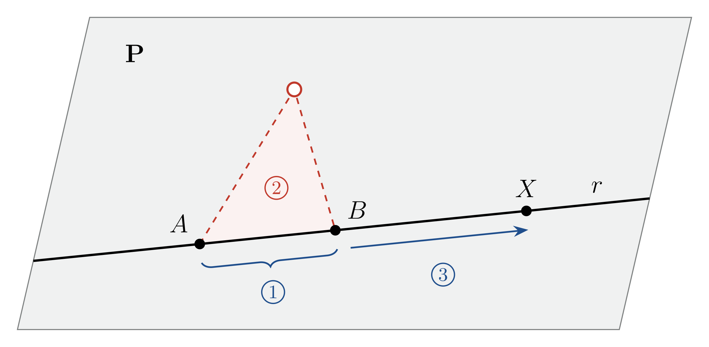
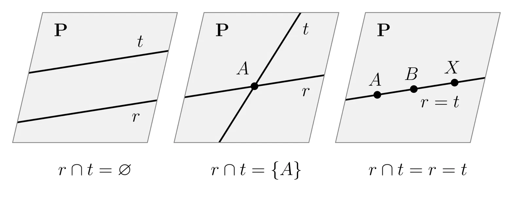
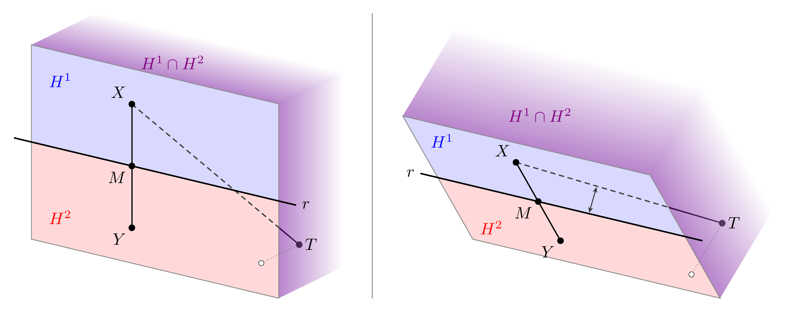

# 0. Index.

1. Introduction.
2. Axiom P1. The plane's metric space. Distance.
3. Lines.
- 3.1. Line: Definition.
- 3.2. Segments and Lines in the plane.
- 3.3. Axiom $P2$: More than one line in $\textbf{P}$. The line passing through two points.
- 3.4. Parallel and Secant lines.
- 3.5. Axiom $P3$: Ruler Postulate.
    - 3.5.1. Definition.
    - 3.5.2. Observation 2.8: Midpoint.
- 3.6. Exercise 1. Characterizating the isommetries of $P3$.
- 3.7. Rays.
    - 3.7.1. Definition.
    - 3.7.2. Observation 2.10. Points in distinct side of a third point.
4. Axiom P4: Separation Axiom.
- 4.1. Definition.
- 4.2. Immediate consecuences.

     

# 1. Introduction.

In this chapter we are going to develop the *Plane Euclidean Geometry* in an axiomatic way. This basically means we will start by announcing some properties assuming them as true or principles (axioms) from which we will develop other properties such theorems, lemma, proposition, etc.

This axioms will be stablished in set theory language, in this sense, we will say that the plane is a set of points, the figures on the plane such lines or triangles are subsets of the plane satisfying some conditions and distances, isommetries and more are applications.

Is important to keep in mind that PEG emerges as an abstraction of what we can draw in a paper with a pencil. The objective of this course is to form the student to instantiate clear or strong intuitions into logically correct and syntactically well-constructed propositions.

 

# 2. Axiom P1. The plane's metric space. Distance.

Let's consider the following two objects:

- The non-empty set called *Plain*; $\textbf{P}$, whose elements are called *points*; $A,B,C \ldots$

- An application $d :  \textbf{P}^2 \to \mathbb{R}$, called *distance*.

The axioms $P1 -P7$ for the PEG will characterize or shape $(\textbf{P},d)$, starting from the first one:

$$\boxed{\text{ Axiom P1: } (\textbf{P},d) \text{ is a metric space}}$$

 

# 3. Lines.

In [metric space's](https://gsanmi1.github.io/posts/2026/11/09/MetricSpaces/) post we discuss the concepts of segments and alignment. We will know extrapolate them in $\textbf{P}$ defining the *line* object.

 

## 3.1. Line: Definition.

A subset $r \subset \textbf{P}$ is called a *line* if the following conditions are meet:

1. $\exists A,B \in r : A \neq B$. 

2. $\forall A,B,C \ [A,B,C \in r \implies Al(A,B,C)] $.

3. $\forall A,B \in r : A \neq B, \forall X \ [Al(A,B,X) \implies X \in r]$.

This means that lines are non-empty, non-singleton $(1.)$, aligned $(2.)$ subsets that owns any point of the plane aligned with his own points $(3.)$.

 

## 3.2. Segments and Lines in the plane.

We are going to see that any segment of endpoints included in a line is a subset of the own line. This is a very intuitive result keeping in mind the definition given above. We recall that segments are those points which do not increment the distance between the endpoints when this is measured passing through them, and alignment between three points literally means for one point to be included in the segment of the other two.

Having said that, let be $r \subset \textbf{P}$ a line and $A,B \in r : A \neq B$ which exists by $(1.)$ and consider $[A,B]$. By definition of the segment:

$$[\forall X \in [A,B] \ (Al(A,B,X) \underbrace{\implies}_{(3.)} X \in r)] \implies  [A,B] \subset r$$

Observe that $A = B \implies [A,B] = \Set{A} \subset r$ since $A \in r$ by premise.

Hence, ultimately, we can state: $[A,B] \subset r \quad \forall A,B \in r$.

 

## 3.3. Axiom $P2$: More than one line in $\textbf{P}$. The line passing through two points.

The following axiom, $P2$, states that in $\textbf{P}$ there is more than one single line to consider in $\textbf{P}$:

$$\boxed{ \begin{aligned}\text{ Axiom P2:}&  \\  (i) \quad & \exists A,B,C : \neg [Al(A,B,C)] \\  (ii) \quad & \forall A,B(A \neq B \implies \exists !r : A,B \in r)\end{aligned}}$$

Observe directly that:

- $(i)$ of $P2$ let us to consider at least one point not aligned with other two in $\textbf{P}$, meaning that the three are not in the same line.

- $(ii)$ of $P2$ let us to consider a line whenever we identify two distinct points of the plane and this line is unique. Note that the uniqness of the line is not necesary, is forced by the alignement logic of the structure (the points of two lines passing through two distinct points are enterely aligned with those two points, hence, each point is in his own line and in the other, thus both lines are in fact the same line).

     

Then, using $P2's (i)$ we can consider three non-aligned points $A,B,C$, (observe that this means they are three distinct points, since one point and two points in the plane are always aligned points). Then, by $P2's(ii)$, we can consider $r$, unique, passing through $A,B$; $g$, unique, passing through $B,C$ and $h$, unique, passing through $A,C$. This three lines are distinct subsets of $\textbf{P}$.

$P2's(i)$ let's to consider it and $P2's (ii)$ let us to build it.

 

For now on, we will design the unique line passing through $A,B \in \textbf{P}$ as $r_{AB}$.

 

## 3.4. Parallel and Secant lines.

### 3.4.1. Parallel and Intersection: Definition.

Let be $r,t \subset \textbf{P}$ two lines, then we say that:

- Both lines are *secant* (or just, both intersect) $\not{\|\|}$ when share a unique point:

    $$r \not{||} \ \ t \iff \exists A \in \textbf{P} : r \cap t = \Set{A}$$

     

- We say both are *parallel* lines $\|\|$ when do not share any points:

    $$r \ \| \ t \iff r \cap t = \varnothing$$

     

### 3.4.2. Theorem 2.7: Characterization of the pairs of lines in $\textbf{P}$.

**Is clear that, given two lines $r,t \subset \textbf{P}$, then, there are three posibilities; both are parallel lines, secant lines, or the same line.** 

As subsets of $\textbf{P}$ if both doesn't share points $r \cap t = \varnothing$, then are parallel, if both share exactly one point $r \cap t = \Set{A}$, then are secant lines.

If both share more than one point, then, let be $A,B \in r \cap t : A \neq B$ and consider $r_{AB}$. The same reasoning is valid for $r$, take some point $X \in t$, then we have by $(2.)$ of lines's definition: $A,B,X \in t \implies Al(A,B,X)$, then also by $(3.)$ $X \in r_{AB}$ and since $X$ is an arbitrary point of $t$, then $t \subseteq r_{AB}$. The same reasoning demonstrates that $r_{AB} \subseteq t$, hence $t = r_{AB} = r$.

 

(Observe that we demonstrate this result by forgetting the uniquity statement of $P2$, then the demonstration would be much sorter. But is worth to demonstrated this way in order to remember that uniquity is not necesary).

 

## 3.5. Axiom $P3$: Ruler Postulate.

### 3.5.1. Definition.

We are already familiar with this result, which basically recovers the analysis's fact about real numbers as positions in a line (Dedekind's cut) and transfer it too the line's subsets of $\textbf{P}$.

Remember that $(\textbf{P},d)$ is a metric space and since any line is a subset of the plane; $r \subset \textbf{P}$, then the set $(r,d\|_{r \times r})$ inheritates the metric space structure from the first one. Having this said, then:

 

$$\boxed{ \text{ Axiom } \text{P3 (Ruler Postulate)}:  \\  Isom((r,d|_{r \times r}),(\mathbb{R},\delta_\mathbb{R})) \neq \varnothing \quad \forall \text{ line } r }$$

 

Observe that we are saying that we can measure the distance between two points in any line as we would measure it in $\mathbb{R}$, this is a very powerful statement since this allow us to translate some mathematical properties of the field $(\mathbb{R},+, \cdot)$ to any line.

Observe that $P3$ let us to consider, for any line $r$, some biyection $\gamma \in \mathbb{R}^r$ that preserves the distance between the points of $r$ and the real numbers (measured the last ones with the absoulte value metric we see in Chapter 1):

$$\delta_\mathbb{R}(\gamma(X),\gamma(Y)) = | \gamma(X) - \gamma(Y) | =  d(X,Y) \quad \forall X,Y \in r$$

Then, we are inyecting the real distance to any generic line in the plane.

 

### 3.5.2. Observation 2.8: Midpoint.

Let's define a useful object in the following sections that also serve us as a good application example of the axiom $P3$. Let $r \subset \textbf{P}$ be a line and $A,B \in r : A \neq B$, then:

- $\exists! M \in r : d(A,M) = d(M,B)$ and we call it *midpoint*.

    By $P3$, we know that we can measure $r's$ as if they were real elements, importing an isommetry from $Isom((r,d\||_{r \times r}),(\mathbb{R},\delta|_\mathbb{R}))$ which is not empty (by $P3$). So, let be $\gamma \in Isom((r,d\|\_{r \times r}),(\mathbb{R},\delta\_\mathbb{R}))$, then, let's call $X$ to be the real unknown satisfying:
    
    $$|\gamma(A) - X| = |\gamma(B) - X|$$

    Squaring both parts, dusing the ifference of square's identity and cleaning $X$ (keeping in mind that $A \neq B$ and $\gamma$ is a biyection) we have that this real number is determinated by the expression:

    $$X = \frac{\gamma(A) + \gamma(B)}{2}$$

    Then, since $X$ do exists as a real number, there must exists some unique $M \in r : M = \gamma^{-1}(X) = \gamma^{-1}(\frac{\gamma(A) + \gamma(B)}{2})$.

     

- Observe quicly the result above forces $M \in [A,B]$, if not, $A,B,M \in r \implies Al(A,B,M)$, (by $(2.)$ of the line's properties), and by the alignment definition in a metric space (which state that three alignment elements means for one of them to be in the segment formed by the other two):

    $$M \notin [A,B] \iff (A \in [M,B] \oplus B \in [M,A])$$

    But:

    $$ \begin{aligned} A \in [X,B] \iff d(M,B) = d(M,A) + d(A,B) \underbrace{>}_{A \neq B} d(M,A)\\ \\  B \in [M,A] \iff d(M,A) = d(M,B) + d(A,B) \underbrace{>}_{A \neq B} d(X,B) \end{aligned}$$

    Hence, by the trycotomy property of the real numbers, the only compatible position for $M$ is to be in the segment of endpoints $A,B$.
    
     

Hence, as a summary, $\forall A,B \in \textbf{P} \ \exists! M \in [A,B] : d(A,M) = d(M,B)$, and we call $M$ to be the midpoint between $A, B \in \textbf{P}$; $M = mid[A,B]$. (Note that trivially $A=B \implies mid[A,B] = A = B$).

 

## 3.6. Exercise 1. Characterizating the isommetries of $P3$.

**Let be $r \subset \textbf{P}$ and $\gamma, \gamma' \in Isom((r,d\|\_{r \times r}),(\mathbb{R},\delta\_\mathbb{R}))$, then** 

$$\exists a \in \mathbb{R} : [(\gamma' \circ \gamma^{-1} (x) = a + x \quad \forall x \in \mathbb{R}) \oplus (\gamma' \circ \gamma^{-1} (x) = a - x \quad \forall x \in \mathbb{R})]$$

Observe that this result is immediate from the fourth section of the exercise 2 of the post of MetricSpaces.

Since:

$$\delta_\mathbb{R}(x,y) = d(\gamma^{-1}(x), \gamma^{-1}(y)) = \delta_\mathbb{R}(\gamma' \circ \gamma^{-1}(x),\gamma' \circ \gamma^{-1}(y))$$

Then, $\gamma' \circ \gamma^{-1} \in Isom((\mathbb{R},\delta_\mathbb{R}))$ and there exists $\tau \in \mathbb{R}$, $\sigma \in \Set{-1,1}$ such:

$$\gamma' \circ \gamma^{-1}(x) = \sigma x + \tau \quad \forall x \in \mathbb{R}$$

Call $\tau = a$ and conmutate the expression, getting:

$$\gamma' \circ \gamma^{-1}(x) =a + \sigma x  \quad \forall x \in \mathbb{R}$$

Note that one of the conclusions we can get from this exercises is that the difference between two isommetries $\gamma, \gamma' \in \mathbb{R}^r$ as $P3$ requires is as much: $\gamma' = \sigma \gamma + \tau : \sigma \in \Set{-1,1} \wedge \tau \in \mathbb{R}$, again, a uniform slidging, with orientation and wide.

 

## 3.7. Rays.

### 3.7.1. Definition.

Let be $r \subset \textbf{P}$, $P \in r, \gamma \in Isom((r,d\|\_{r \times r}),(\mathbb{R},\delta\_\mathbb{R}))$, then we define as *ray with vertex $P$* to the sets:

$$\Set{Q \in r \mid \gamma(Q) > \gamma(P)}, \quad \Set{Q \in r \mid \gamma(Q) < \gamma(P)}$$

We often can refer to any of both sets as $\overline{r}$. Observe that both rays doesn't joint in to $r$:

$$\Set{Q \in r \mid \gamma(Q) > \gamma(P)} \cup \Set{Q \in r \mid \gamma(Q) < \gamma(P)} = r \setminus \Set{P}$$

We say two points $S,T$ are on the same side of $P$ when both are in the same ray with vertex $P$.

 

Let's do a minor observation to discuss why we the ray do not depedend on the select $\gamma$. Intuitively, we did see in exercise $6.1$ that any $h \in (\mathbb{R},\delta_\mathbb{R})$ is essentially a uniform oriented sliding (what later we'll call a translation plus a rotation over a line) over $\mathbb{R}$, since this the only way to preserve distances in a line.

Formally, if $a,b,c \in \mathbb{R}$ distinct, the trycotomy and transitivity properties of the total order in $\mathbb{R}$ stablish that, for example and without loose generality: $a < b < c$. If we choose an isommetry $h$, there exists $\sigma \in \Set{-1,1} \wedge \tau \in \mathbb{R} : h(x) = \sigma x + \tau$. Then, the images of $a,b,c$ by $h$ satisfies: 

$$\begin{cases}h(c) - h(b) = \sigma (c-b) > 0 \\ h(b) - h(a) = \sigma (b-a) > 0\end{cases}$$

Then, we have two posibilities depending on the value of $\sigma$:

$$\begin{cases} h(a) < h(b) < h(c) \quad \sigma = 1 \\ h(c) < h(b) < h(a) \quad \sigma = -1\end{cases}$$

Geometrically we would say that $h$ "preserve" the segment (remember that in any metric space is $[x,y] = [y,x]$). 

Observe nevertheless that an isommetry could invert the orientation, this is important in $\mathbb{R}$ because any point is identified by a number which is distinguishable from any other through a total order, we will see that $r$, despite be isommetric, is not a full copy of $\mathbb{R}$ in $\textbf{P}$ (is just a metric copy) and one of the differences is precisely this one, so orientation in the lines of the plane doesn't matters at all.

Axiom $P3$ tell us that any line $r$ in the plane is an isommetric structure to $\mathbb{R}$, hence, any traduction of the line to $\mathbb{R}$ done by some isommetry $\gamma \in \mathbb{R}^r$ as $P3$ requires is in summary a replication of the slidging shown above. Meaning that, take $r \subset \textbf{P}$ and $X,Y,Z \in r$, distinct, such $Z \in [X,Y]$. Then, in terms of $\gamma$ is $\gamma(Z) \in [\gamma(X), \gamma(Y)]$, let's suppose $\gamma(X) < \gamma(Z) < \gamma(Y)$, now, let be $\gamma ' \in \mathbb{R}^r$ another isommetry as $P3$ requires, then $\gamma' \circ \gamma^{-1} \in Isom(\mathbb{R},\delta_\mathbb{R})$ and just as we see above there are two posibilities:

$$\gamma(X) < \gamma(Z) < \gamma(Y) \implies \begin{cases}\gamma' \circ \gamma^{-1}(\gamma(X)) < \gamma' \circ \gamma^{-1}(\gamma(Z)) < \gamma' \circ \gamma^{-1}(\gamma(Y)) \\ \gamma' \circ \gamma^{-1}(\gamma(X)) > \gamma' \circ \gamma^{-1}(\gamma(Z)) > \gamma' \circ \gamma^{-1}(\gamma(Y))\end{cases}$$

But $\gamma'\circ \gamma^{-1}(\gamma(X)) = \gamma'(X) \quad \forall X \in r$, then:

$$\gamma(X) < \gamma(Z) < \gamma(Y) \implies \begin{cases}\gamma'(X) < \gamma' (Z) < \gamma' (Y) \\ \gamma'(X) > \gamma' (Z) > \gamma'(Y)\end{cases}$$

Which means that essentially the election of $\gamma$ doesnt matter in the ray definition because it preserves the segments and only invert the line as much, but, since the points in a line are indistinguisable among them (despite the distance's identification) this is not much of a problem.

In other words, the election of $\gamma$ could interchange both rays relative to a vertex of a line as much, but as a matter of a fact, we dont care because this change isn't metrically appretiable.

 

### 3.7.2. Observation 2.10. Points in distinct side of a third point.

Two points $X,Y \in r$ are in different sides of $P \in r$ only iff $P \in [X,Y]$. Let be some $\gamma \in \mathbb{R}^r$ as $P3$ requires, then, if $X$ and $Y$ are in different sides of $P$ in $r$ it could satisfy, without loose generality: 

$$\gamma(X) < \gamma(P) < \gamma(Y) \iff \gamma(P) \in [\gamma(X), \gamma(Y)] \iff P \in [X,Y]$$

Note that since $[X,Y] = [Y,X]$, the case $\gamma(X) > \gamma(P) > \gamma(Y)$ is exactly the same, the equivalence presentation closes the demonstration.

 

# 4. Axiom P4: Separation Axiom.

## 4.1. Definition.

Above we did split a line in a point and identified two sides relative to the vertex. We are now going to present the separation axiom, $P4$, which extends this splitness to the whole plane $\textbf{P}$.

 

$$\boxed{ \begin{aligned}\text{ Axiom P4:} &  \quad  \forall \text{ line } r \ \exists H^1, H^2 \subset \textbf{P} :   \\  (i) \quad & H^1 \cup H^2 = \textbf{P} - r \\  (ii) \quad & \forall X,Y( X,Y \in H^i \implies  [X,Y] \subset H^i) \quad i = 1,2 \quad \\ (iii) \quad & \forall X,Y( (X \in H^i \wedge Y \in H^j) \implies  [X,Y] \cap r \neq \varnothing) \quad i,j = 1,2; \quad j \neq i \quad \end{aligned}}$$

 

Let's observe something interesting, let's take two distinct points $M, M' \in \textbf{P}$ and consider the line $r_{M,M'}$. Then, by axiom $P2$, consider a third point $X \in \textbf{P} : \neg Al(X,M,M') \iff X \notin r_{M,M'}$, and consider $Y \in \textbf{P} : M = mid[X,Y]$, then we call:

$$H^1 = \Set{T \mid [T,X] \cap r_{MM'} = \varnothing }$$

$$H^2 = \Set{T \mid [T,Y] \cap r_{MM'} = \varnothing }$$

Is easy to see that $(i)$ and $(ii)$ applies for our construction, how ever, how can we garantee $(iii)$? $(iii)$ is basically the statement that asserts that is impossible to go from one set to the other without cross $r_{MM'}$, but this is not true in three dimensions geometry for example:

$P4$ commit us to believe that $\textbf{P}$ is a metric structure for which the line is enough and necesary to split it in half and, as a consecuence, is a garantee that the cost of go through a line is to cut it. In summary, $P4$ is what converts $\textbf{P}$ as a metric structure into a plane.

 

We call $H^i, \ i=1,2$ half-plane of edge $r$. We say two points of $\textbf{P}$ are in the same side of $r$ if both are in the same half-plane.

 

## 4.2. Immediate consecuences.

Observe that, as a consecuences of the postualtes of $P4$:

- $H^i \neq \varnothing \quad i = 1,2$

    We demonstrated this before, is garantee by $P2$. In $\textbf{P}$ there are at least three points not aligned so at least one of them is not empty, then considering the line passing through the not aligned point and the other, we can infere that the opposite set is also not empty.

     

- $H^1 \cap H^2 = \varnothing$

    This is precisely what follows from $(iii)$. Reasonning to the absurd, suppose: $H^1 \cap H^2 \neq \varnothing$, then:

    $$X \in H^1 \cap H^2 \underbrace{\implies}_{(iii)} ([X,X] \cap r \neq \varnothing \iff X \in r) \implies H^1 \cup H^2 \neq \textbf{P} - r$$

    Entering in contradiction with $(i)$.

     

- $P^i \in H^i \implies H^i=\Set{T \mid [T, P^i] \cap r = \varnothing} \quad i = 1,2$

    Observe that:
    
    $$X \in H^i \iff [X,P^i] \subset H^i \iff [X,P^i] \cap r = \varnothing$$
    
    We also see that $(i)$ and $(ii)$ emerges naturally, hence, the $Axiom P4$ core is in fact the third condition; $(iii)$.

     

