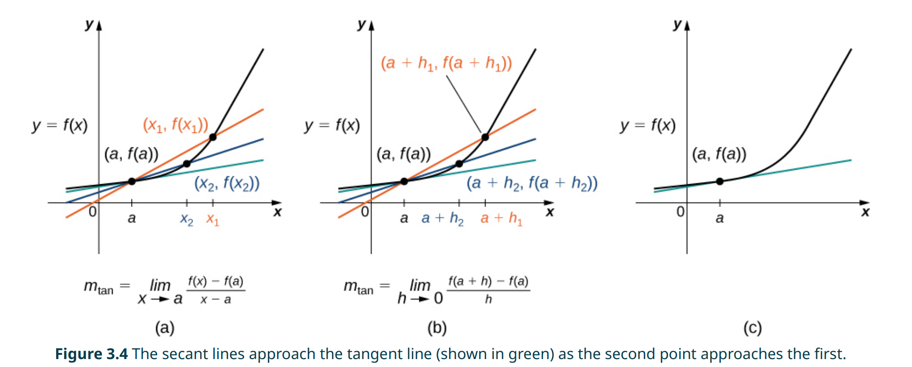

# 0. Index.

1. Introduction.
2. Defining the Derivate.
- 2.1. Difference Quotient. Tangent Line to a function at a point.
- 2.2. The derivate of a Function at a Point.
- 2.3. Derivative Interpretation: Velocity.

 

# 1. Introduction.

This course's purpouse is to give an introduction to calculus from a physics perspective based on the material of calculus volumes from [openstax.org](https://openstax.org). In all the following, we will forgo mathematical rigor in favor of a powerful intuitive and visual conception of the concepts presented.

 

# 2. Defining the Derivate.

## 2.1. Difference Quotient. Tangent Line to a function at a point.

Let $f$ be a function defined in an interval $I$, and let be $a,x \in I : x \neq a$, then we define as the *difference quotient* to:

$$Q = \frac{f(x) - f(a)}{x - a}$$

This quotient can be reformulated taking $h : x = a + h$ and simply substituting:

$$Q = \frac{f(a + h) - f(a)}{h}$$

Is an incremental quotient with increment $h$.

 

Then, let's consider the graph of $f$ and consider the line passing through $(a,f(a)),(a+h,f(a+h))$, observe that as $h$ gets smaller, is easy to see visually, that the line $l$ became tangent instead of secant to the graph:

 

 

Hence, we define the tangent line to $f(x)$ at $a$ is the line passing through the point $(a,f(a))$ having slope:

$$m_{tan} = \lim_{x \to a} \frac{f(x) - f(a)}{x -a} = \lim_{h \to 0} \frac{f(a+h) - f(a)}{h}$$

Provided this limit exists.

 

Observe that we can form the equation of the tangent line using the point-slop form of the line:

$$f(x) = m_{tan} (x - a) + f(a)$$

 

## 2.2. The derivate of a Function at a Point.

We are now going to formally presentate the limit to which we give a geometrical interpretation; the *derivative*. The process of finding a derivative is called *differentiation*.

 

**Definition**

Let $f(x)$ be a function defined in an open interval containing $a$. 

The derivative of the function $f(x)$ at $a$, denoted by $f'(a)$, is defined by

$$f'(a) = \lim_{x \to a} \frac{f(x) - f(a)}{x - a} = \lim_{h \to 0} \frac{f(a+h) - f(a)}{h}$$

provided this limit exists.

 

## 2.3. Derivative Interpretation: Velocity.

We are going an example of application of the derivate of a function at a point which is directly implied by the direct interpretation of the derivate: **The derivate of a function measures the instantaneous rate of change at a point**.

 

Recall that if $s(t)$ is the position of an object moving along a coordinate axis, *the average velocity of the object over a time interval* $[a,t]$ (if $a < t$, $[t,a]$ if is $t < a$) given by the difference quotient:

$$v_{[a,t]} = \frac{s(t) - s(a)}{t - a}$$

Then, observe that as $t$ approaches $a$, $v_{[a,t]}$ get's closer to the instantaneous velocity at $a$, hence, as we seen above:

$$v(a) = s'(a) = \lim_{t \to a} v_{[a,t]} = lim_{t \to a} \frac{s(t) - s(a)}{t - a}$$

