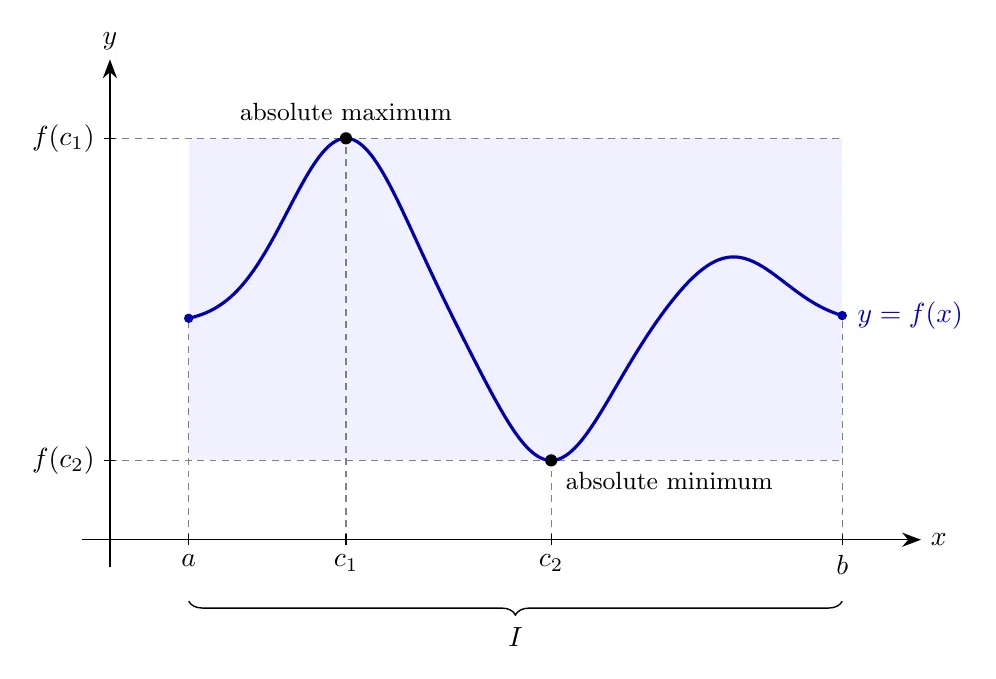
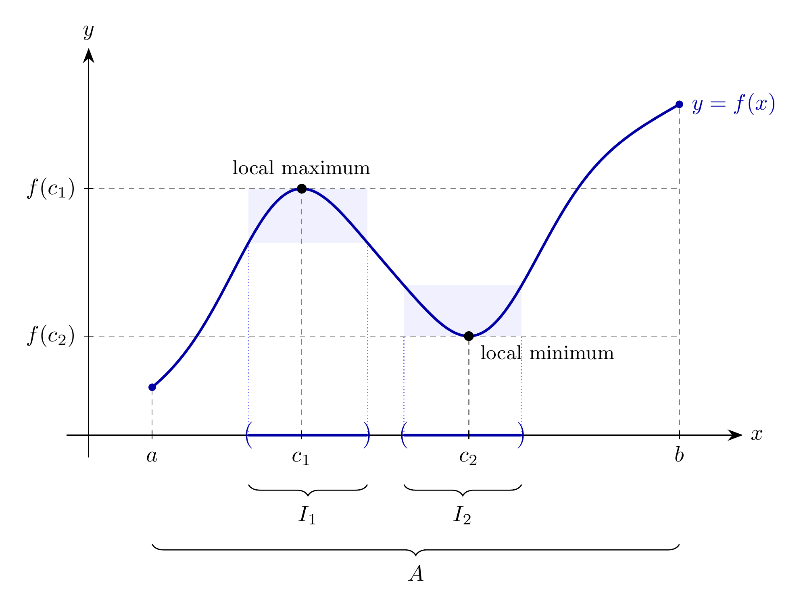
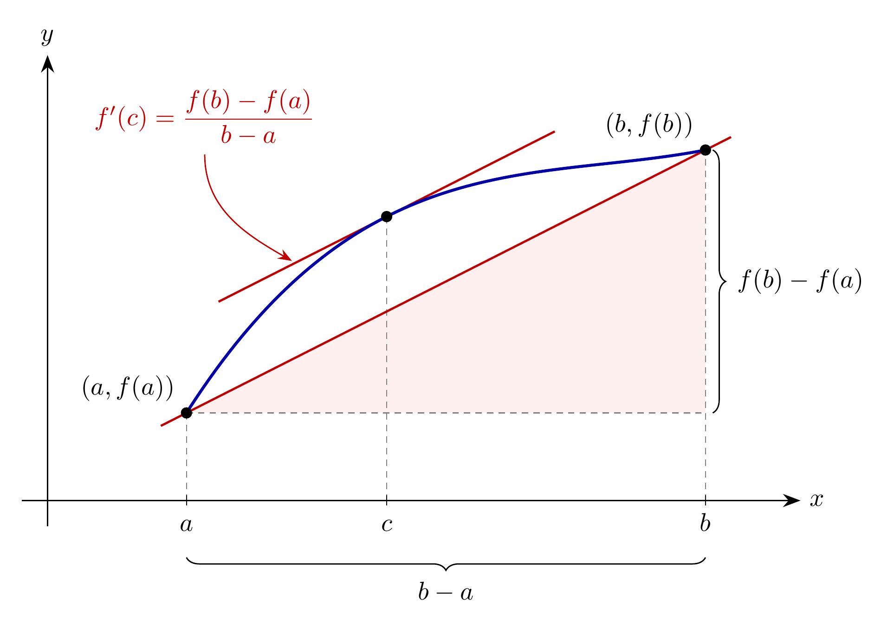

# 0. Index.

 

# 1. Introduction.

We did see in the [Derivate](https://gsanmi1.github.io/posts/2026/11/17/Calculus_Derivatives/) post the definition of the derivate and the differentiation and how to do the main differentiation operations.

Now we are going to see main applications of derivates in mathematics.

 

# 2. Maxima and Minima.

Given a particular function, we are often interested in determining the largest and smallest values of the function. This information is important in creating accurate graphs. Finding the maximum and minimum values of a function also has practical significance because we can use this method to solve optimization problems.

## 2.1. Definition: Absolute Extrema. Extreme Valure Theorem.

Let $f$ be a function defined over an interval $I$ and let $c \in I$. 

- We say $f$ has an **absolute maximum** on $I$ at $c$ if

    $$f(c) \geq f(x) \quad \forall x \in I$$

     

- We say $f$ has an **absolute minimum** on $I$ at $c$ if

    $$f(c) \leq f(x) \quad \forall x \in I$$

     

If $f$ has an absolute maximum on $I$ at $c$ or an absolute minimum on $I$ at $c$, we say $f$ has an **absolute extremum** on $I$ at $c$.

The **extreme value theorem** states that if $f$ is a is a continuous function over a closed, bounded interval, $[a,b]$, then $f$ has garanteed the existance of an absolute maximum and an absoluted minima in $[a,b]$

 

## 2.2. Definition: Local Extrema. 

Local extrema get's compared between all the points of the domain of $f$, the same conception applied to a narrower subset of the domain of definition of $f$ gives birth to the local extrema:

- A function $f$ defined in $A$ has a **local maximum** at $c$ if there exists an open interval $I \subset A$ containing $c$ such that:

    $$f(c) \geq f(x) \quad \forall x \in I$$

     

- A function $f$ defined in $A$ has a **local minimum** at $c$ if there exists an open interval $I \subset A$ containing $c$ such that:

    $$f(c) \leq f(x) \quad \forall x \in I$$

     

A function $f$ has a **local extremum** at $c$ if $f$ has a local maximum at $c$ or $f$ has a local minimum at $c$.

 

## 2.3. Definition: Critical Points. Fermat's theorem.

Critical points are points subtle to be either Absolute or Local extrema.

 

Let $c$ be an interior point in the domain of $f$. We say that $c$ is a **critical number** of $f$ if $f'(c) = 0$ or $f'(c)$ is undefined. We call the point $(c, f(c))$ a critical number of $f$. Note that these two terms are often used interchangeably in this text and elsewhere.

 

As mentioned earlier, if $f$ has a local extremum at a point $x = c$, then $c$ must be a critical number of $f$. This fact is known as **Fermat's theorem**: If $f$ has a local extremum at $c$ and $f$ is differentiable at $c$, then $f'(c) = 0$.

Observe that this fact can be appretiate in the images above, always a point is an absolute/local extrema always has $0$ slop tangent but is convenient to remeber that is also appliable when $f'(c)$ is undefined.

 

## 2.4. Problem-solving strategy.

Let $f$ be a continuous function over a closed, bounded interval $I$. The absolute maximum of $f$ over $I$ and the absolute minimum of $f$ over $I$ must occur at endpoints of $I$ or at critical points of $f$ in $I$.

With this idea in mind, let's examine a procedure for locating absolute extrema.

**Locating Absolute Extrema over a Closed Interval**

Consider a continuous function $f$ defined over the closed interval $[a, b]$.

1. Evaluate $f$ at the endpoints $x = a$ and $x = b$.
2. Find all critical points of $f$ that lie over the interval $(a, b)$ and evaluate $f$ at those critical points.
3. Compare all values found in $1$ and $2$. From Location of Absolute Extrema, the absolute extrema must occur at endpoints or critical points. Therefore, the largest of these values is the absolute maximum of $f$. The smallest of these values is the absolute minimum of $f$.

     

# 3.  Mean Value Theorem's theorem.

The Mean Value Theorem is one of the most important theorems in calculus. We look at some of its implications at the end of this section. First, let’s start with a special case of the Mean Value Theorem, called Rolle’s theorem.

## 3.1. Rolle's theorem.

**Let $f$ be a continous function over the closed interval $[a,b]$ and differentiable over the open interval $(a,b)$ such $f(a) = f(b)$, then, there exists at least one $c \in [a,b] : f'(c) = 0$.**

 

Observe that by the Extreme Value Theorem, $f$ is continue in a closed, bounded, interval, so it has garanteed in that such interval the existance of absolute extrema values. 

Now, observe that the image of the endpoints of the interval coincide ($f(a) = f(b)$), hence, this only can be absolute maximums or absolute minimum (or nothing at all) at the same time. By the Fermat's theorem, the remain absolute extrema value (or the two of them) must be a critical point, which we do know is $c \in [a,b] : f'(c) = 0 \vee f'(c) \text{ is undefined }$.

However, since $f$ is differentiable in $[a,b]$, for each $c \in [a,b]$, $f'(c)$ is meant to exists, hence it cannot be undefined and it can only be $f'(c) = 0$. (Observe that the differentiable condition in $(a,b)$ is crucial).

So, in summary, $\exists c \in (a,b) :  f'(c) = 0$.

 

## 3.2. Mean Value Theorem.

The Mean Value Theorem generalizes Rolle’s theorem by considering functions that do not necessarily have equal value at the endpoints. Consequently, we can view the Mean Value Theorem as a slanted version of Rolle’s theorem.

The Mean Value Theorem states that if $f$ is continuous over the closed interval $[a,b]$ and differentiable over the open interval $(a,b)$ then there exists a point $c \in (a,b)$ such that the tangent line to the graph of at is parallel to the secant line connecting $(a,f(a)), (b,f(b))$.

 

**Let be $f$ continous over the closed interval $[a,b]$ and differentiable over the open interval $(a,b)$. Then,** 

$$\exists c \in (a,b): f'(c) = \frac{f(b) - f(a)}{b-a}$$

 

The proof follows from Rolle's theorem by building some $g$ satisfying Rolle's condition departing from $f$. Consider the line passing through $(a,f(a)), (b,f(b))$, then the slope is, by Pitagoras, the incremetal quotient from $a$ to $b$ and the equation of the line has the form:

$$y = \frac{f(b) - f(a)}{b-a}(x-a) + f(a)$$

Then we consider the function:

$$g = f - y \iff g(x) = f(x) - \frac{f(b) - f(a)}{b-a}(x-a) + f(a)$$

Note that $y$ connects the endpoints of the interval, hence $g(a) = 0$ and $g(b) = 0$ and it satisfies the Rolle's condition, so:

$$\exists c \in (a,b) : g'(c) = f'(c) - \frac{f(b) - f(a)}{b-a} = 0$$

 

This theorem states ultimately that the derivative coincides with the average rate of change at some intermediate point. Not just any point, nor one that you can necessarily locate.

 

## 3.3. Implications of the Mean Value Theorem.

We are going to present important implications of the Mean Value Theorem.

### 3.3.1. C

 